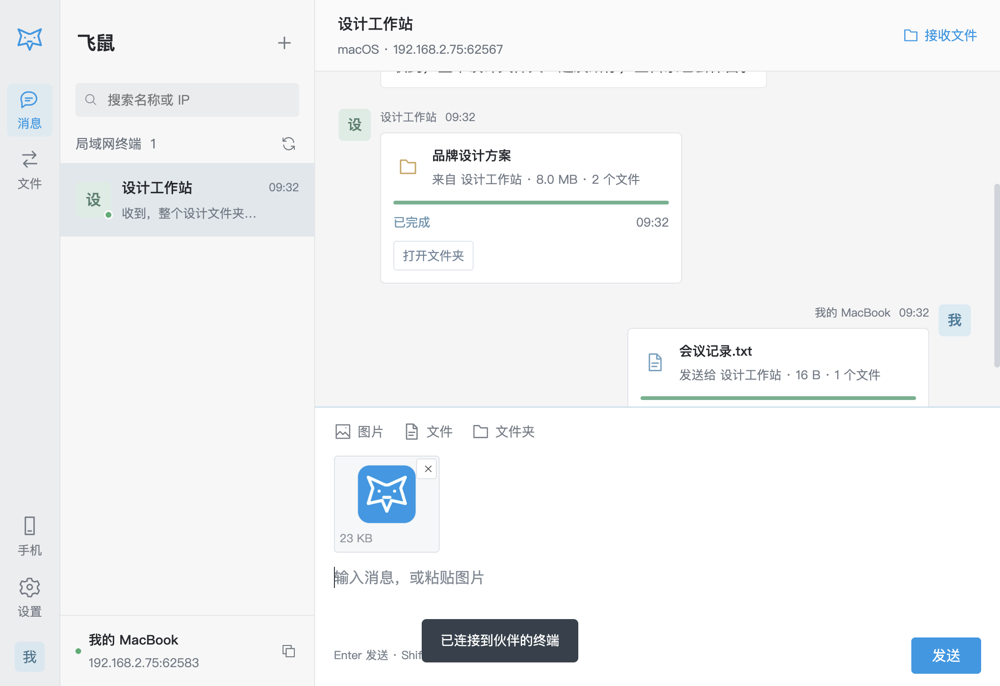

# 飞鼠 · FlyingMouse

开源的局域网协作客户端，支持 macOS、Windows 与 Android。无需账号和中心服务器，同一局域网的电脑可以相互发现、发消息、发送大文件和整个文件夹。


## 1.2.1：字号与可读性

聊天正文和输入框为 16px，终端名称为 15px，时间为 12px，文件详情/进度为 13px；其余提示与操作通常为 13–15px，窄窗口不再缩小到 9px。加深辅助文字颜色并增加列表宽度、文件卡片和控件空间，继续采用系统中文字体。Android 聊天为 16sp，辅助文字至少 13sp，按钮为 15sp，跟随系统字体缩放。

## 1.2.0：简洁界面与图片粘贴

- 软件名称由“邻讯”改为“飞鼠”，采用灰白底、蓝色强调的简洁聊天布局，文件进度直接显示在会话中，全部记录集中在「文件」页。
- 桌面输入框支持 **Cmd+V（Mac）/ Ctrl+V（Windows）** 粘贴截图、复制的图片，也可点工具栏「图片」。先显示缩略图，可移除，点「发送」或 Enter 后才发送。对方确认接收后传输；支持同时暂存最多 10 张，每张生成的 PNG 不超过 25 MB。图片转换为 PNG，不保证保留原始文件格式；需要原文件时用「文件」发送。
- 图片草稿按终端隔离，切换会话不会把图片误发给其他设备。单张常见格式图片完成传输后在聊天中显示缩略图（预览文件上限 10 MB）；大图仍可正常传输。
- Android 支持兼容输入法的图片 `commitContent` 和长按粘贴带内容 URI 的图片，先进入待发送列表再确认。普通文字粘贴保留；具体图片入口取决于输入法和来源应用是否提供授权 URI。
- 保留旧通信协议和应用 ID，可与邻讯 1.0 / 1.1 互传；Android 使用原签名覆盖升级。桌面检测到旧「邻讯」资料目录时沿用，终端 ID、名称、聊天与接收路径继续保留。新安装默认保存到下载目录的「飞鼠」。Mac 安装新包后请退出并移除旧应用图标，避免同时运行新旧客户端。



## Android 手机端

已增加 Android 8.0+ 原生客户端。手机可接收微信系统分享的单张/多张图片、文件和文字，也可通过系统选择器选取图片、视频、文件或文件夹。支持电脑与手机双向传输、进度、接收确认、聊天和自定义终端名称。

安装 `dist/FlyingMouse-1.2.1-android.apk`，或在电脑端左侧点击「手机」，让同一 Wi-Fi 的手机扫码下载安装。已有电脑端 1.0 也兼容手机端，不强制升级。微信没有系统分享入口时，先保存图片，再从飞鼠选择发送。

[Android 安装、权限、后台运行和构建说明](android/README.md)

## 已实现

- UDP 组播 + 广播自动发现，终端上下线状态；手动输入 IPv4 和端口连接，HTTP 心跳保持在线。
- 自定义终端名称，跨 macOS / Windows 双向文本聊天，中文、多行消息、未读计数和本地历史记录。
- 多文件、多个文件夹、拖放发送；递归保留子目录、空目录、零字节文件。
- 接收方确认后才写文件；可拒绝、取消、重新发送；独立传输记录和打开接收目录。
- 双方实时进度条、已传字节、速度、预计剩余时间；每个文件流式计算 SHA-256 并校验。
- 文件流带背压，内存用量不随文件大小线性增长；已测试 **4 GiB + 17 字节** 文件。
- 新建独立接收目录，不覆盖同名文件；路径穿越防护、跨平台路径检查、接收空间检查。
- 桌面通知、终端搜索、保存位置设置，应用单实例保护。

## 直接运行

构建产物在 `dist/`，不需要安装 Node.js：

- **Apple Silicon Mac**：使用文件名含 `arm64` 的 `.dmg` 或 `.zip`，也可以直接打开 `dist/mac-arm64/飞鼠.app`。
- **Intel Mac**：使用不含 `arm64` 的 Mac 包，或打开 `dist/mac/飞鼠.app`。
- **Windows x64**：`Setup` 文件为安装包，另一个 `.exe` 为免安装版本。`dist/win-unpacked/飞鼠.exe` 为未压缩的完整应用（需保留整个文件夹）。

[下载安装包与 SHA-256 校验文件](https://github.com/wonderful200x-ui/linx-lan/releases/latest)。macOS 构建使用完整的 ad-hoc 签名并强制验证资源封装，但尚未使用 Apple Developer ID 签名或苹果公证，首次打开仍可能被拦截。核实下载来源和校验值后，尝试打开一次，再到「系统设置 → 隐私与安全性 → 仍要打开」。Windows 可能显示 SmartScreen 提示。

如果旧 Mac 安装包提示「已损坏」，请退出应用，将“应用程序”中的旧 `邻讯.app` 或 `飞鼠.app` 移至废纸篓，重新下载已修复的 DMG 并安装。此操作不删除用户资料目录。不要覆盖旧包、修改签名或全局关闭 Gatekeeper。[Apple 官方说明](https://support.apple.com/zh-cn/102445)。

开发者构建时默认使用 `mac.identity: "-"`，并在签名后运行 `codesign --verify --deep --strict`，校验失败会终止打包。正式公证发行需提供自己的 Developer ID Application 证书和 Apple 公证凭据，并将 `mac.identity` 覆盖为该证书；ad-hoc 签名不提供开发者身份认证。

在两台电脑上打开飞鼠，连接同一个 Wi-Fi 或有线局域网。在左侧选择对方终端即可聊天。发送文件或文件夹后，对方在聊天中的文件卡片点击「接收文件」，或在左侧「文件」页接收。点击左下角设置可修改终端名称及接收位置。

## 从源码启动

需要 Node.js 22 或更新版本（建议 Node.js 24 LTS），以及 npm。

```sh
npm ci
npm start
```

在 Windows PowerShell / 终端和 macOS 终端中均使用以上命令。依赖版本由 `package-lock.json` 固定。首次安装需要联网下载 Electron；安装完成后，客户端运行不依赖互联网。

```sh
npm run check        # JavaScript 语法检查
npm test             # 双服务集成测试
npm run test:large   # 4 GiB + 17 字节传输与哈希校验（临时磁盘至少 9 GiB）
npm run test:ui      # 真实 Electron 界面端到端测试及截图，需要图形桌面
npm run dist:android # 可选：先构建 Android APK，供桌面版内置扫码安装
npm run pack        # 当前平台的应用目录
npm run dist:mac -- --arm64 --x64
npm run dist:win -- --x64
```

macOS 的 DMG 应在 macOS 上构建。Windows 安装包优先在 Windows 构建；在 macOS 交叉构建时，electron-builder 会下载对应工具。`.github/workflows/build.yml` 提供两平台构建工作流：手动触发，或推送 `v*` 标签后，在 Actions 的 artifacts 中下载产物。源码仓库：[wonderful200x-ui/linx-lan](https://github.com/wonderful200x-ui/linx-lan)。工作流支持手动触发；桌面构建先取得 Android 构建产物以提供扫码安装功能。APK、DMG 和 EXE 等安装包不会随源码提交，可从 Releases 下载发行版，从成功的 Actions 下载构建产物，或自行构建。

## 网络连接

- 自动发现：IPv4 UDP **45893**，组播地址 `239.255.77.88`，同时尝试广播。
- 消息和传输：应用启动时分配的 **TCP 端口**，本机首页和左下角显示 `IP:端口`。
- 请允许应用访问本地网络、通过 macOS / Windows 防火墙；接收目录需要可写权限。
- 自动发现失败时，在另一台电脑的「＋ → 手动连接」输入本机显示的 IPv4 地址和端口。已知终端还会使用 HTTP 心跳，维持在线状态。
- 访客 Wi-Fi 的客户端隔离、不同 VLAN、VPN 或路由器禁止组播可能影响连接；手动连接仍要求两机 TCP 可达。
- 多网卡时，首页显示各 IPv4 地址，请选择双方可互通的地址。自动发现仅覆盖当前广播域；不提供公网打洞或转发。

## 文件与数据约定

默认接收位置为系统下载目录下的「飞鼠」。每批传输创建一个 `飞鼠-随机字符` 目录，原始目录结构保留在其中。只有大小和 SHA-256 校验通过后，临时文件才会改成正式文件名。失败或取消时，已经成功接收的文件保留，正在接收的临时文件删除。

聊天和最近 100 条传输摘要保存为应用用户数据目录中的 `state.json`。消息保留最近 2,000 条；历史摘要不包含发送方源文件列表。终端名称和接收位置也保存在本机。

- 支持单批最多 **10,000 个文件及目录条目**，超出时请拆批发送。
- 单个文件没有人为设置 4 GB 限制，受文件系统、剩余磁盘空间及 JavaScript 安全整数范围限制。FAT32 接收盘不能保存 4 GB 以上文件。
- 同批次仅大小写不同的路径、Windows 保留名称、Windows 不支持的字符会明确报错，避免跨平台静默覆盖或丢失文件。
- 符号链接、设备文件等特殊文件不传输。文件夹传输保留路径和文件内容，不复制权限、扩展属性、资源叉或原始修改时间。
- 等待接收最长 10 分钟，网络数据停滞 60 秒会中止；应用退出时中止活动传输。当前不支持断点续传；「重新发送」会从头开始，同一次应用会话可直接重试，重启后需重新选择文件。
- 当前是局域网 **HTTP 明文传输**，没有账号、可信设备配对或端到端加密；SHA-256 用于完整性校验，不提供对端身份认证。仅用于可信局域网，终端名不代表已验证身份。

## 结构

```text
src/main.cjs          Electron 生命周期、文件选择、受限 IPC、系统通知
src/preload.cjs       隔离的桌面 API 桥接
src/core/service.cjs  发现、心跳、HTTP 协议、流式传输、完整性校验、持久化
src/ui/              HTML / CSS / JavaScript 界面，无远程页面或 CDN 依赖
test/                真实网络收发集成测试
scripts/ui-smoke.cjs  Electron 端到端测试，通过本机临时调试端口执行；生产启动无此端口
```

界面使用 Electron 的 context isolation、sandbox、禁用 Node integration 和内容安全策略；只暴露按操作划分的 IPC 方法，并验证调用页面来源。实现遵循 [Electron 安全建议](https://www.electronjs.org/docs/latest/tutorial/security) 和 [上下文隔离文档](https://www.electronjs.org/docs/latest/tutorial/context-isolation)。

MIT License。

## 参与贡献

欢迎提交 Issue 和 Pull Request。请先阅读 [贡献指南](CONTRIBUTING.md)；已知安全边界见 [安全说明](SECURITY.md)。
